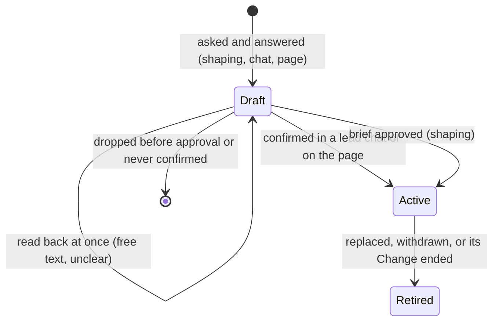

# Decisions as Confirmed Intent: Build Design

> **Owning task:** item 14 of [the plan](owlbear-plan.md); owner decisions TD-448..TD-459 (2026-10-21)
> **Date:** 2026-10-21
> **Question:** How should OwlBear record, share and apply decisions so each one is the owner's confirmed intent?
> **Status:** answered by the owner; slice 1 built, slices 2 to 6 not. It revises [the decision system](decision-system-build.md), whose
> built parts it reuses. Made from Sol's design and a second Sol's challenge, after the owner's correction that a
> decision is his intent, not his words.

## 1. The unit

A decision is one plain statement of what the owner wants (or of an agent's choice, marked as the agent's), with its
reach (Global, a project, one Change), optional reason and consequences, and its links. Only confirmed intent is
stored; the owner's words never are, not in files, the record or commit messages (TD-449). Ids exist; pages show
titles, as the owner asks of every report.

| Field | Meaning |
| --- | --- |
| statement | The confirmed intent, at most two lines |
| scope | Global, project or Change; the owner sets it (shaping already asks) |
| origin | `decided` (the owner confirmed it), `approved` (it came with a brief he approved), `autonomous` (an agent's) |
| read_back | The date the owner last confirmed the statement, `pending` while a read-back waits, `none` for agents' choices and inherited ones |
| inherited | Brought over from the record and never read back (TD-454) |
| topics | Search tags agents set without asking (TD-455) |
| state | Draft, active, retired (replaced, withdrawn or done) |

`owner_words` goes; rationale and consequences stay optional and say who wrote them.

## 2. Where decisions are made

| Where | Path |
| --- | --- |
| Shaping a Change | Asked in the owner's format; free text and unclear answers read back at once, a chosen paraphrase counts as confirmed; one closing check of everything to be saved before the brief is saved (TD-448). The brief also names the existing decisions the picker found for the Change (TD-455, TD-459). Drafts until approval; active from approval (TD-453) |
| Requests during the work | Pause, retry, rounds, task selection, setup, pack choices stay events of the Change. A clarification within the brief is confirmed like any answer and becomes a Change decision, active at confirmation. An answer that changes the approved brief is an amendment: the work stops and asks, until item 16 designs amendments |
| Lead chats outside Delivery | OwlBear's own decisions and ad-hoc project chats: asked and read back the same way, saved at confirmation through decision tools that find the project by its repository (TD-450); the closing check ends the session |
| Decisions page | Look up, change, retire, widen scope: each change is shown as a plain statement and confirmed like an answer; impact report (TD-428); inherited decisions read back when work relies on an unclear one (TD-454, TD-427) |
| Settings, Backlog, Memory | Their own stores; settings are not copied into decisions |
| Comments | Input, classified like a request: applied when operational, confirmed when they carry intent |

## 3. Owner and agent decisions

Agents (TD-451): within approved work or something the owner delegated ("take your recommendation"), an agent
chooses reversible details freely and records each consequential choice as its own; that choice applies to the work
at once and shows in the Change and on the page, never as the owner's. Anything lasting (project or Global), wider in
scope, contrary to an owner decision, or committing outside (cost, accounts, publishing) asks the owner first and then
follows the owner's path.

| | Owner decision | Agent decision |
| --- | --- | --- |
| Origin | `decided`, or `approved` with a brief | `autonomous` |
| Read-back | At once for free text and unclear answers; closing check | Listed in the closing check and at brief approval |
| Applies | From brief approval or confirmation | To its work at once; lasting ones only after the owner |
| Changed by | Only the owner | An agent with a reason; a second reversal goes to the owner |

## 4. Who sees what (TD-452, TD-456 to TD-459)

- **Picking:** a separate picker on Sol at medium effort reads the complete list of active Global and project
  decisions once at shaping and picks the rules the Change must follow, doubtful ones included; approval pins them in
  the Change's baseline (TD-459). Measured on 13 past pull requests against a reference list: 94% of the task's own
  rules and 97% of the general ones, 4 consequential misses, about 6 credits and a minute per pick. Sol high found
  96% and 98% at 15.6 credits and about 5 minutes; Haiku, Luna and Opus found less.
- **Later decisions:** the Change's own decisions attach automatically. A project or Global decision activated
  elsewhere applies at once (TD-453); like a rule replaced or withdrawn elsewhere, or a widened scope, the picker
  reassesses it for the running Change at its next step boundary. An answer that changes the brief still stops the
  work (TD-456).
- **Workers** get the whole picked set, untrimmed and the same for every role: no role or kind tags, no per-role
  views; topics stay search tags (TD-455, TD-457, TD-458). Measured: Opus trimming halved the set but lost 2 to 3
  rules that mattered, and as its own call cost about what it saved.
- **Lookup:** workers and lead chats ask the same picker, which reads the complete list; a failed lookup shows as
  failed, never as "no rules apply" (TD-456, TD-459).
- **Challengers** (brief, plan, review) check the complete list (TD-452).
- **Correction log:** wrong picks and misses, each with the condition that made it wrong, correct the picker's
  guidance; no statistics, no automatic filters (TD-456).
- No fixed size limit; binding text is never cut; other projects' decisions are never visible.
- Statements that only make sense next to their neighbours ("on those pages") were missed by every model, so the
  migration makes each one readable on its own (slice 6).

## 5. Saving and syncing

The operating context the owner gave on 2026-10-21: one OwlBear host per machine, at most two machines, never the same
project. Project folders therefore never meet, only Global is shared, and no distributed locking is needed.

| What | Where | Written | Synced to | When | Why |
| --- | --- | --- | --- | --- | --- |
| The owner's words | Nowhere | Never | Nowhere | — | TD-449 |
| Shaping drafts | The Change's database (`~/.owlbear/projects/<id>`) | Each brief save | Nowhere | — | Survive a broken session; only that Change needs them |
| Lead-chat drafts | The conversation | — | Nowhere | — | Saved only once confirmed |
| Active decisions | `owlbear-data`: Global at the root, `<project>/decisions/`, `<project>/changes/<change>/decisions/` | At activation and retirement | GitHub | Pushed at once; pulled at host start, step start or resume, before publishing or merging | One place every agent and both machines read; history |
| Picked revisions | The Change's baseline; archived with its finished-Change record | At approval and accepted updates | `owlbear-data` | Change end | Reproducible work; impact reports |
| Search index | Local SQLite | After each pull or save | Nowhere | — | Fast search |
| OwlBear's generated view | OwlBear's repository | On change, by pull request | GitHub | — | GitHub's cloud reviewers; a dated copy, supplementary |

"Up to date" means checked at those boundaries: a relevant change found there stops the affected work and asks (the
built gate). A failed push is shown and retried; the other machine sees the decision at its next pull. A clash between
two machines can only be in Global and becomes a conflict for the owner.

## 6. Bringing over the record

Every in-force line becomes an inherited decision: its statement, its recorded origin, Global as TD-442 lists, topics
as search tags, no quotes, nothing reviewed up front (TD-454, TD-455). An inherited decision is read back when work
relies on it and its meaning is unclear. Before the switch, a test on past Changes and lead-chat tasks checks that
the picker plus the challenger finds every governing decision; then the record becomes a generated view and its
quotes live on only in Git history.

## 7. Reused and changed

Reused: decision files and validator, the store with revision checks and receipts, the gate and baselines, the
read-back queue, the impact report, the Decisions tab, the generated view and the converter.

Changed: `owner_words` removed everywhere; a confirmed decision is active at once instead of a draft the owner
activates (TD-450); project decisions of a brief published at approval instead of Change end (TD-453); a worker's
context is the whole picked set plus lookup through the picker, a challenger's the complete list (TD-452, TD-457,
TD-459); decision tools in every workspace
by repository identity and wired into SDK steps; the closing check in the asking rules and the shaping skill (TD-448);
the agents' boundary in their agent files (TD-451); the page in plain words without ids.

## 8. Slices

| # | Content | Proof |
| --- | --- | --- |
| 1 | Model: `owner_words` removed, `inherited` added, `read_back` set by confirmation; page without ids | Old files load; no new write or migrated decision carries words (Git history keeps what it has) |
| 2 | Decision tools in every workspace by repository identity, OwlBear's included: find, record confirmed, change, retire; active at once; the closing check in the asking rules and both asking skills | A decision confirmed in an unregistered workspace is found after a restart from another workspace |
| 3 | The brief lists the picked decisions; a brief's project decisions published at approval; abandonment revokes nothing | A project decision approved in one Change reaches a parallel Change at its next step |
| 4 | The picker on Sol medium at shaping and for every lookup; the whole picked set to every worker; challengers' complete list; the correction log; the agents' boundary in their files | A rule the picker left out is caught by the challenger in a fixture; a failed lookup is reported as failed |
| 5 | Requests classified as event, clarification or amendment | A clarification becomes a Change decision; a brief-changing answer stops the work |
| 6 | Migration as inherited, the past-work test, the switch | The test finds every governing decision; the record becomes a generated view |

**Riskiest assumption:** the picker plus the challenger finds every decision that governs the work. A first test on
13 past pull requests (2026-10-21) chose the picker's model; slice 6's test on past Changes and lead-chat tasks checks
it again on the migrated statements before the switch.
