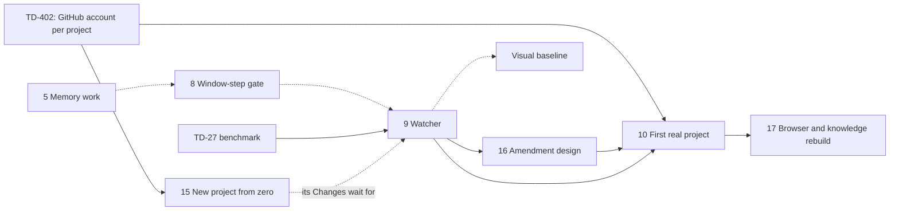

# OwlBear Plan and Status

> **Owning task:** owner request 2026-10-19: one document that grounds any session in what is built, what comes
> next and where the code differs from the decisions
> **Date:** 2026-10-22, status at `main` after #580 and this pull request, decisions to TD-469 and item 5's four of
> 2026-10-22
> **Question:** Where does OwlBear stand, in what order does the remaining work come, and where does the code
> differ from the decisions in force?

Read this first when you start or resume work, and again after a context compaction. The owner's decisions live in
`owlbear-data`, read through [their generated view](../decisions.md) or the decision tools (by topic C-01 to C-31 and
the standalone decisions); how each part is built is in its build document (§6). This file holds only status, order
and gaps. Keep it current as §7 says.

## 1. Status Quo

**Product.** OwlBear Delivery (`serve/delivery-next`, package `owlbear_delivery_next`) is the only Delivery that
runs: one machine host serves every registered project with one UI (Changes, Backlog, Memory, Decisions, Settings,
Maintenance).
The old engine is gone (TD-199, #521 to #524); its source stays at the tag `delivery-v1-final`. The old Cockpit is
gone too (TD-416, #527); the machine UI's pages are the only frontend.

**Use.** No real project uses OwlBear (TD-338); this laptop is the only instance. Two sandbox projects are
registered: `owlbear-sandbox` and `owlbear-sandbox-protected`. OwlBear itself is developed in chat (TD-319 allows
both), through pull requests to `main` with the required `CI` check, strictly up to date, merged as merge commits.

**Runtime.** `~/.owlbear/runtime` is an alias to the active version under `~/.owlbear/versions/`; OwlBear updates
itself to each new tag when idle, or at once with `owlbear update` or Run updates now (TD-415, items 3 and 4).

**Versions.** The release workflow tags labelled merges (`release:minor`, `release:major`) once their push `CI`
passes; the switch `RELEASE_TAGS` is on since 2026-10-19 14:39Z. Tags from `v0.1` exist; v1.0 is the merge of the
pull request that marked item 12 done, tagged `v1.0` and `v1`. The
walk creates tags through the REST API with the owner's fine-grained token `RELEASE_TOKEN` (Contents and Workflows
write, TD-404), since GitHub refuses the workflow token tags on commits whose workflow files differ from every branch
tip; a major gets `vN.0` and `vN` (TD-392). The token expires; the owner renews it.
Renovate's pull requests come back now that the old engine is gone (owner, 2026-10-19).

**Built, by build document:**

| Area | Build document | Pull requests |
| --- | --- | --- |
| The engine and the whole journey, shaping to cleanup, visual check, design pack | [architecture](https://github.com/maba-pag/owlbear-data/blob/main/owlbear/research/delivery-next-architecture.md), [design skill](delivery-next-design-skill.md) | #449 |
| Review and challenge rounds for every role (TD-208, steps 1 to 8) | [challenge rounds](https://github.com/maba-pag/owlbear-data/blob/main/owlbear/research/challenge-rounds-build.md) | #449; steps 6 to 8 as commits before the PR route |
| Pull requests with required CI (TD-278) | [PR, CI, merge queue](https://github.com/maba-pag/owlbear-data/blob/main/owlbear/research/pr-ci-merge-queue-build.md) | #455 to #458 |
| Merge-queue support (TD-226) | [PR, CI, merge queue](https://github.com/maba-pag/owlbear-data/blob/main/owlbear/research/pr-ci-merge-queue-build.md) | commits before the PR route, `0d4272eef` and its repairs |
| Per-role session time limits, doubled (TD-286) | — | #460 |
| Pages on lit-html (TD-264), machine host, one UI, Global memory, SQLite stores, settings across projects | [machine host](https://github.com/maba-pag/owlbear-data/blob/main/owlbear/research/machine-host-build.md) | #461 to #469, #471 |
| Self-update steps 1 to 3b: machine settings, Pause, paused maintenance, PR labels, push CI, release walk | [self-update](https://github.com/maba-pag/owlbear-data/blob/main/owlbear/research/self-update-build.md) | #473, #476, #478, #480 to #482 |
| Test curation of delivery-next (TD-311, TD-312) | — | #477 |
| Decision review TD-319..TD-381: Snyk Code and Renovate, Cyclopts, subagents per role, owner notes as written | the record | #483, #487 to #489, #492, #494, #495 |
| The machine preference layer and session limits (TD-336) | [settings scopes](https://github.com/maba-pag/owlbear-data/blob/main/owlbear/research/settings-scopes-build.md) | #496, #497 |
| The test review from the Maintenance page (C-26) | [test review](https://github.com/maba-pag/owlbear-data/blob/main/owlbear/research/test-review-build.md) | #498, #499 |
| Self-update steps 3c to 5: pack updates through a PR, versions, standby and handover, idle updates | [self-update](https://github.com/maba-pag/owlbear-data/blob/main/owlbear/research/self-update-build.md) | #516 to #520, #525 |
| The old engine's removal in five batches, documentation for v1.0 | [transfer ledger](https://github.com/maba-pag/owlbear-data/blob/main/owlbear/research/delivery-next-transfer-ledger.md) | #521 to #524, #526 |
| Cockpit's memory purge on the Memory page, Cockpit deleted (TD-416) | — | #527 |
| Pages on the design system's CDN only, split into modules under the line limit (TD-39, TD-398, TD-401) | [visual baseline §3.6](delivery-next-visual-baseline.md) | #529, #530 |
| Conflicts with read-back decisions: the agent workspace hidden from Git (TD-420), CI lint from the pre-commit config (TD-409), a repeated finding linked to every match (TD-405) | — | #535 to #537 |
| The decision system (item 14) except the migration: files and validator, Change decisions archived, store with receipts, step context and runner gate, Decisions tab and chat tools, generated view, read-back queue, impact report, fix entries ticked by merged Changes | [decision system](https://github.com/maba-pag/owlbear-data/blob/main/owlbear/research/decision-system-build.md) | #538 to #547, #550 |
| Memory: the residuals of #238, #244 and #249; a chat's memory in its project's folder of `owlbear-data` (TD-72) | — | #548, #553 |
| Decisions as confirmed intent (item 14): inherited decisions, saving at confirmation, the picker and lookups, answers classed by their relayer, the migration and the switch to `owlbear-data` (TD-466) | [decisions as confirmed intent](https://github.com/maba-pag/owlbear-data/blob/main/owlbear/research/decision-intent-build.md) | #556 to #565, #570, #571 |

## 2. The Plan

The order is the owner's (TD-394): TD-358's build work, the research move, self-update steps 3c to 5, the old
engine's removal, v1.0, TD-318's memory work, the window-step gate, the watcher; TD-403 places the build work of
TD-392..TD-402; TD-338 puts the watcher before any real project. TD-419 puts the decision system next,
before item 5; TD-422 puts the amendment design session before item 10, after the watcher. Item numbers are stable
names, not positions: the table lists the items in their order.

| # | Work | Decided by | Build document | Status |
| --- | --- | --- | --- | --- |
| 1 | TD-358's rest: none; built: TD-328, TD-330, TD-334, TD-335, TD-341, TD-345 (with TD-405, TD-406), TD-347's skill, TD-350, TD-392, TD-396, TD-397, TD-399 (§3.1) | TD-358, TD-403 | TD-330 in [challenge rounds](https://github.com/maba-pag/owlbear-data/blob/main/owlbear/research/challenge-rounds-build.md) §3.4; TD-334 in [machine host](https://github.com/maba-pag/owlbear-data/blob/main/owlbear/research/machine-host-build.md) | Done |
| 6 | Research move: OwlBear's research into `owlbear-data`; the decision record, this plan and build designs of unbuilt work stay (§3.3) | TD-227, TD-347, TD-395, TD-394 | §3.3 | Done |
| 2 | Self-update step 3c: design pack updates through a pull request, with C-15's updater and challenger rules | TD-325, TD-357, TD-368, TD-194, TD-177 | [self-update §8](https://github.com/maba-pag/owlbear-data/blob/main/owlbear/research/self-update-build.md) "Step 3c build" | Done |
| 3 | Self-update step 4: `repo.git`, versions, never backwards, selfcheck, standby, handover, Run updates now | TD-239, TD-299, TD-300, TD-352..TD-354, TD-369 | [self-update §3–§5, §11](https://github.com/maba-pag/owlbear-data/blob/main/owlbear/research/self-update-build.md) | Done (#517 to #519; this machine's first update to v0.20 on 2026-10-20, TD-415) |
| 4 | Self-update step 5: idle, use, announcement, automatic updates | TD-301, TD-288 | [self-update §7, §11](https://github.com/maba-pag/owlbear-data/blob/main/owlbear/research/self-update-build.md) | Done (#520) |
| 7 | Old engine removal: tag `delivery-v1-final`, five dependency-closed batches, three skills retired with batch 3, docs rewritten | TD-199, TD-201, TD-203, TD-394 | [transfer ledger §3.4](https://github.com/maba-pag/owlbear-data/blob/main/owlbear/research/delivery-next-transfer-ledger.md), [cutover §3.3, §3.6, §3.7](https://github.com/maba-pag/owlbear-data/blob/main/owlbear/research/delivery-next-cutover.md) | Done: tag `delivery-v1-final`, batches 1 to 5 (#521 to #524), its issues and pull requests closed, the documentation rewritten for v1.0 (#526) |
| 11 | Pages: the PDS fallback and notice removed, browser tests on the real CDN; then pages, scripts and styles split to the 500-line limit (§3.4) | TD-39, TD-398, TD-401, TD-403 | [visual baseline §3.6](delivery-next-visual-baseline.md) for the removal | Done (#529, #530): the fallback is removed; the pages split into modules under `web/pages/` |
| 13 | Cockpit: audit `serve/cockpit` for what the machine UI lacks (design-system components and workarounds, memory purge, the ideas editor), port what is worth it, delete Cockpit | TD-416 | none | Done (#527): memory purge ported to the Memory page; the ideas editor, theme toggle and workspace health dropped; one lesson for item 11 in [visual baseline §3.6](delivery-next-visual-baseline.md) |
| 12 | v1.0: the first `release:major` merge, tagged `v1.0` and `v1` | TD-393, TD-392 | [self-update §4, §8](https://github.com/maba-pag/owlbear-data/blob/main/owlbear/research/self-update-build.md) | Done: the first `release:major` merge (2026-10-20) |
| 14 | Decision system: decisions as their own system for OwlBear's work and every project, in `owlbear-data`, scoped Change, project and Global; Decisions page with read-backs; impact of a change of mind | TD-419, TD-418, TD-424..TD-430 | [decision system](https://github.com/maba-pag/owlbear-data/blob/main/owlbear/research/decision-system-build.md) | Built: slices 1 to 4 and 5a (#538 to #542: file contract and validator, Change decisions archived, store with receipts and index, step context with the runner's gate, Decisions tab with owner actions and chat tools), 6 (#543: generated `.owlbear/decisions.md`, its hash checked on pull requests and against owlbear-data by `decisions-view.yml`, TD-436) and 5b part 1 (the read-back queue on the Decisions tab, at most three at a checkpoint, `queue_read_back`, and OwlBear's own decisions as a fixed scope, TD-427, TD-435) and 5b part 2 (an impact report per project for a replaced or withdrawn decision, the owner's "forbids existing behaviour" or "wording only" mark, scheduling fixes as grouped backlog entries and accepting a project's existing code, each the owner's click, TD-428). Next: the owner reviewed the migration preview on 2026-10-21 (TD-439 to TD-446), then had decision management rethought end to end and decided it the same day (TD-448 to TD-455): decisions record his confirmed intent only, a lead chat saves at confirmation, workers get the Change's whole picked set while challengers check all, today's rules come over as inherited. A picker on Sol medium picks each Change's rules at shaping and answers lookups; every worker gets the whole picked set (TD-456 to TD-459, from a model test on 13 past pull requests). Next: the six slices of [decisions as confirmed intent](https://github.com/maba-pag/owlbear-data/blob/main/owlbear/research/decision-intent-build.md), the migration being the last; slices 1, 2 and 3 are built (slice 3: a brief's project decisions published in force by its approval, which a failed save refuses; a failed push shown on the Change and sent by the next save; never demoted at its end), and of slice 4 the picker (a brief version's decisions picked before its first challenge, checked and pinned at approval) and the runtime switch (every role of a step gets the pinned picked set plus the Change's own, whole and without a size limit; challengers get the complete list beside it; decisions new since the pick go to the picker in one batch at the next step boundary, a failed pick waiting and retrying; path, role and step selectors removed, TD-460) and the lookup (`lookup_decisions` for a step's own worker, its spend on the Change, and for lead chats through the project host or the machine host's OwlBear mount: the picker over the complete list, a failed lookup reported as failed, TD-456, TD-459) with the agents' boundary in their files (TD-451); slice 4 is complete. Slice 5 is built: the relayer of an answer to a worker's question (a lead chat's `answer_question` or the Changes page) classes it as event, clarification or brief change; a clarification carries the statement the owner confirmed when it was read back, a Sol check on the picker's role compares it with the approved brief, and within it the statement becomes a decision of the Change, in force from that step; a brief change, or a clarification the check finds changing the brief, is never delivered and stops the work with the owner's choice to answer within the brief or stop the Change, until item 16 designs amendments (TD-461). Slice 6 is built: the converter applied `.owlbear/migration/decisions-overlay.json` (130 lines reworded to stand alone after two Sol checks, TD-462; 22 Global by TD-442) and its `REPORT.md` shows each original beside its rewording; the owner reviewed it on 2026-10-22: he checked only the four Sol left uncertain (TD-464), which were split or retired (TD-467 to TD-469); lines of mixed origin carry decided (TD-465); the 28 orphan rows were cited, spent or restored (TD-40), and the quality-service line split by TD-442. The past-work test on the final preview missed nothing new, and the record switched to owlbear-data (TD-466): 22 Global and 324 OwlBear decisions are authoritative there, and the record, converter and overlay are in Git history. Item 14 is complete |
| 5 | After v1.0: project agents and skills off in steps (TD-274's gap); the memory work: curator modes and threshold (95%), moving an entry back, the saver's pre-set, sorting existing project memories once; from the closed memory issues: a test for two writes in the same microsecond (#238), dispute history in the memory tools' answers (#244), the memory handbook's revision parameter (#249) | TD-317, TD-329; TD-292, TD-293, TD-318, TD-400; the session's four of 2026-10-22 (threshold measure, triggers, move back, sort) | [memory work](memory-work-build.md) | Designed with the owner on 2026-10-22: six slices, built in the order 1, 2, 6, 3, 4, 5. Slice 1 is built: `save_memory` takes the saver's recommended scope (`where`), stored as `recommended` and shown on pending entries of the Memory page. Slice 6 is built: a step session turns config discovery off and the runtime's bundled skills off explicitly, so it loads only its role's agent and Delivery's skills while the repository's instructions still load; a probe on SDK 1.0.22 showed discovery was already off by default, now pinned against a changed default. Of slice 3, the threshold is built: a global-only setting, 95% by default, on the Settings page under Memory curation (the owner's answer of 2026-10-22). The three residuals from #238, #244 and #249 are built |
| 8 | Window-step gate: windows keep repository hooks and user MCP servers out, subagents detected and counted, judge effects contained | TD-223, TD-145, TD-342 | none yet | Not started; no design. Its starting point: TD-267, the `websockets` library's sync `unix_connect` replaces `ahp.py`'s hand-written WebSocket code as the first commit, with size limits, keepalive, close and error mapping chosen explicitly |
| 9 | Watcher: TD-27's benchmark, then the design session (O1–O6) with the owner, then the build and its proof | TD-224, TD-316, TD-365, TD-378, TD-47 | [watcher design](delivery-next-watcher-design.md), [options](delivery-next-watcher-options.md) | Not started; the draft needs revising (§3.5) |
| 16 | Amendment design session with the owner (TD-185), end to end, before any amendment code | TD-185, TD-422 | none yet | Not started |
| 10 | First real project: the per-project GitHub account setting first; memory publication and curation (F17) fixed; two Changes merged in consumer projects; OwlBear builds itself through Delivery | TD-338, TD-402, TD-90, TD-319 | none yet | Waits for item 9 |
| 17 | Browser and knowledge rebuilt from scratch, from the [ideas of the closed issues](https://github.com/maba-pag/owlbear-data/blob/main/owlbear/research/closed-issue-ideas-2026-10.md); until then the packages stay untouched | TD-434 | none yet | After item 10 |

**Not yet placed** (decided or planned, no position in the order):

- Visual baseline: "before" captured in shaping, retake, preview ports (TD-38, TD-40); its PDS part is item 11. The
  repair plan of 2026-10-11 put it after the watcher, because its live proof needs a runtime the owner can follow.
  [Plan](delivery-next-visual-baseline.md), nothing built.
- The amendment design (TD-185) is item 16 now (TD-422).
- New project from zero (TD-421, TD-431..TD-433, item 15): [design](new-project-build.md), answered by the owner;
  it pulls TD-402's per-project GitHub account forward; a project created this way waits for the watcher.
- The quality service (TD-89): [research](https://github.com/maba-pag/owlbear-data/blob/main/owlbear/research/repo-quality-service.md), not built.
- Contradicting findings of the two visual judges go to the owner ([design skill §3.5](delivery-next-design-skill.md));
  they are not detected (§3.7 there).
- An organisation with the merge queue for OwlBear's `main`, once someone else contributes or Delivery builds
  OwlBear (TD-326).
- Delivery's chat server in `.mcp.json`: the Copilot runtime's format allows no `${userHome}` or `${workspaceFolder}`,
  so it stays in `.vscode/mcp.json` until an `owlbear mcp` command (repository = working folder) ships in a release;
  then its entry becomes `owlbear mcp` with no paths.
- The "align" fixes of §4 that belong to no item above: small, each its own pull request.

**What depends on what** (open work only; solid: needed first, dashed: decided order without a technical need):

Independent of everything else: TD-402 (small, before item 15), the align fixes of §4 and the quality service.
Renovate's #451 and #452 merged on 2026-10-22: the topology diagram re-rendered with Archify 3.2.0, and Renovate now
raises `package.json`'s Node floor with `.nvmrc`. Item 14's runner gate only stops and asks until item 16 designs amendments; its CI
freshness check (slice 6) runs with the owner's `OWLBEAR_DATA_TOKEN` secret (TD-436).

**The old roadmap.** The roadmap M0–M7 and the repair plan of 2026-10-11 are history at `04b1d8ec4` (§3.7 and §3.12
of the old record). Older documents still name their milestones: M0 to M4 are done (M4 is #449 and what followed);
E1 is part of item 7; M5 is item 10; M6 is item 7; M7's size and style rules are C-28. The repair plan's phases 1
and 2 are done, phase 3 is item 9, phase 4 is the visual baseline, phase 5 was replaced by the runtime design, and
of phase 6 the collision rule (C3, TD-12) is built and the change of mind (C5) is the amendment design.

## 3. Next Steps in Detail

### 3.1 Item 1: TD-358's remaining build work and TD-403's small items

TD-358 ("All of it now, before self-update step 3b") was recorded after step 3b had merged (#481), so it is read as
"before the rest of the self-update"; TD-394 confirms it comes first. The audit of §4 found the eight below unbuilt;
the range's other rows are built, history, or part of steps 3c and 4 (TD-325, TD-352, TD-353, TD-357). TD-403 adds
the small items of 2026-10-19. Built since: TD-392 (#502), TD-328, TD-341, TD-347's skill, TD-396, TD-397 and TD-399,
with the C-02 catalogue text (#506), TD-345 with TD-405 and TD-406 (#508), TD-350 (#509), TD-335 (#510), TD-330
(#511) and TD-334: item 1 is done. TD-334 moves a store still in the clone into `~/.owlbear/projects/<id>` on its
first open; the clone keeps its id and a format marker that every older runtime refuses.

### 3.2 Items 2 to 4: the self-update

Item 2, [self-update §8](https://github.com/maba-pag/owlbear-data/blob/main/owlbear/research/self-update-build.md) "Step 3c build", is built. A pack update commits on `pack/<run>`
from a clean checkout of `main`, opens a labelled pull request, waits for the required checks, brings the branch up to
date and merges it; whatever stops it asks the owner, and a host restart during publication waits for him instead of
failing. In line with C-15 the updater may change the pinned skills, the golden pages and the detector's glue; anything
else, changed expected evidence, a change the challenger is unsure the upgrade needs and a glue change go to the owner,
the glue checked with the running code (TD-414); the challenger judges every changed file. Steps 4 and 5 are §3–§5 and
§7 there.

### 3.3 Items 6 and 7: research moved, then (after the self-update) the old engine

The research moved on 2026-10-20: 1,156 documents went to `owlbear-data/owlbear/research/`, with a README there that
says how their relative links resolve. Here stay this plan and the build designs of work not
yet built (TD-395): design skill (judge conflicts), visual baseline, watcher design and options. A design moves
there once its work is built; the transfer ledger and cutover followed with item 7, the self-update and PR/CI/merge
queue designs with v1.0. Links from what stays point at the moved
documents' GitHub pages. Agents write research to the project's folder in the data repository (`w-research` Step 6,
`r-workspace-governance`), OwlBear's included; `.owlbear/research/` takes only the plan and new build
designs. The old engine's designer went with batch 3 of item 7.

The removal follows the self-update (TD-394) and the ledger's batches 1 to 5 (the
`main` sync batch is gone, TD-203) with the tag first; its precondition for batch 2 (the new Changes page reachable)
holds. It rewrites the documentation v1.0 needs (TD-393). The old engine's issues #225 and #400 and pull requests #405
and #412 closed with it; Renovate's pull requests come back after it. Batch 5 also retired the
four seeded hooks only the old agents registered; `deny-src-writes.py` stays for the test curator. The old live state
(`.owlbear/delivery/`, `.owlbear/controller/`) stays on disk until D5's endpoint, two consumer Changes merged on the
new engine (item 10).

### 3.4 Items 11 and 12: pages, then v1.0

The PDS fallback is gone as the [visual-baseline plan §3.6](delivery-next-visual-baseline.md) lists: the 3-second
decision, the `pds` flag, every native-control branch, the `.no-pds` CSS and its notice; the confirmation and the
screenshot viewer are `p-modal`s, and the browser tests let `cdn.ui.porsche.com` through instead of aborting it
(TD-398). The module test now counts every page, script and style the package owns, the vendored `web/vendor/` and
`web/pds/` aside (TD-401), and the three large pages split by section: each keeps its markup and styles, and its
script became ES modules under `web/pages/<page>/`, served from a list fixed at startup as `/assets/page/<page>/<name>`.
`changes.html` went from 1496 lines to 128, `config.html` from 1102 to 39, `backlog.html` from 524 to 55; no module
has more than 259.
v1.0 is the first merge labelled `release:major`, after items 1, 6, 2, 3, 4, 7, 11 and 13; it is tagged `v1.0` and `v1`.
Item 14, the decision system (TD-419), is built (#538 to #547); the owner reviewed the migration preview (TD-439 to
TD-446), then had decision management rethought and decided it (TD-448 to TD-462, [design](https://github.com/maba-pag/owlbear-data/blob/main/owlbear/research/decision-intent-build.md)).
Its slices 1 to 5 are built (#556 to #565); slice 6 is done: the owner reviewed the preview (TD-464 to TD-469), the
final preview passed the past-work test, and the record switched to `owlbear-data` (TD-466); the record and its
converter are Git history. Item 5's three
residuals from closed issues are built (#548); the rest of item 5 needs a design.

### 3.5 Items 8 and 9: gate, then watcher

Neither has a build design. The watcher draft predates TD-320 and TD-365: it assumes the SDK guard denies outside
writes (TD-45, replaced), while now nothing blocks them and the watcher judges each one afterwards. It must be revised
before the owner's design session, which comes when window steps are about to return (TD-224, TD-316). TD-27's
benchmark runs before the watcher's model is chosen (TD-378). The owner's input of 2026-10-21 for the revision:
Claude Code's "You should know" observer, which tells the user the one consequential thing he likely missed and
otherwise stays silent ([watcher design §3.4b](delivery-next-watcher-design.md)).

## 4. Where the Code Differs From the Decisions

Audit of every in-force line of the record against `main` `23bd7c1ab` on 2026-10-19 (eight read-only reviews,
key gaps confirmed in the code), updated for the owner's answers TD-392..TD-403 the same day and rechecked on
2026-10-21 after #535 to #553. Only gaps are listed;
every other line is built as decided. Action: **align** the code to the decision, **build** planned work, **keep**
as is for the reason given. Item: the plan item of §2 that picks it up.

| Line | Decision | Code today | Action | Item |
| --- | --- | --- | --- | --- |
| C-03 | TD-27's benchmark, then the watcher's model | Not run | build | 9 |
| C-04 | The watcher reads, judges and stops every runtime; it is on the real-use list | Not built | build | 9 |
| C-04 | Window steps reopen only after the gate | Gate not built, no design | build | 8 |
| C-04 | A missing tool reruns once in a runtime that has it | No other runtime while window steps are paused | keep | 8 |
| C-11 | Shaping captures the target pages; approval waits for them (TD-38) | "Before" is taken at the check | build | visual baseline |
| C-11 | A target whose UI changed since shaping gets a retake | Partly | build | visual baseline |
| C-14 | Bounded delegation, the "weaker" rule, the amendment process, fields and baseline | Partly; blocked by the open design TD-185 | keep | not placed |
| C-16 | OwlBear's own project sets `release:minor` | OwlBear is not a registered project | keep | 10 |
| C-19 | Add project can create a new project from zero (TD-421) | Only an existing clone can be added | build | 15 |
| C-20 | OwlBear builds itself through its own Delivery (TD-319) | Developed in chat only | keep | 10 |
| C-25 | The saver recommends a scope (TD-293) | Missing | align | 5 |
| C-25 | A Global entry can move back to a project (TD-292) | The page says it does not move back | align | 5 |
| C-25 | Curator modes and the Global threshold, 95% at first (TD-292, TD-400) | Missing | build | 5 |
| C-25, C-27 | The watcher saves lessons and infers stages | Not built | build | 9 |
| C-26 | Tests do not assert prose wording | Two memory-governance tests still assert curation wording (identity deferral, corroborated scope): kept until a behavioural test covers the rule | align | — |
| C-28 | Tool use is measured, success rates included (T8) | Counted per Change and shown on its page (TD-463); no view across Changes, and wrong-tool selection shows only as missing-tool reports | align | — |
| C-28 | Default rules guide, never gate | Ruff's complexity rule fails CI; `noqa` is the escape | keep | — |
| C-30 | Every role may use built-in subagents | Not in window steps | keep | 8 |
| S | A project setting names the account for GitHub writes, by default the owner's when `gh` has it (TD-402) | `maba-pag` does everything; both sandboxes are `boecht`'s | build | 10 |
| S | A quality service runs linters and judges exceptions (TD-89) | Not built | build | not placed |

Record repairs made with this document: the trim of 2026-10-19 had listed TD-228, TD-250 and TD-358 as spent,
dropped C-21's lines for TD-199 and TD-201 and cut TD-318's schedule to one of its four parts; they are back in force.

## 5. Open Questions for the Owner

Ask each with the question tool in the owner's format (workspace instructions, "Asking the Owner"). Answered on
2026-10-19 as TD-392..TD-403: the v1.0 tags and timing, the order of the remaining work, which saves confirm, the
test review while paused, the research move's timing and scope, the PDS fallback, which roles save memory, the
curator's threshold, what the line limit covers and the GitHub account. Answered on 2026-10-20 as TD-417..TD-438:
the step-kind cap, the recording rule and the decision system, the agent workspace, a new project from zero, the
amendment session's timing, the browser and knowledge rebuild; on 2026-10-21 as TD-439..TD-455: the migration
preview, CodeRabbit, and decisions as confirmed intent.

1. None open.

## 6. Documents

Links to GitHub pages point into `owlbear-data/owlbear/research/`, where the built designs and the research live
since item 6; the others are in this folder.

| Document | Role | Status |
| --- | --- | --- |
| [Decisions](../decisions.md) | The generated view of the owner's decisions in `owlbear-data` | Current; the decisions are the authority for intent |
| This file | Status, order, gaps, open questions | Current |
| [Self-update](https://github.com/maba-pag/owlbear-data/blob/main/owlbear/research/self-update-build.md) | Build design of items 2 to 4 and the v1.0 tags | Built (steps 1 to 5, v1.0) |
| [Settings scopes](https://github.com/maba-pag/owlbear-data/blob/main/owlbear/research/settings-scopes-build.md) | Machine layer and session limits | Built (#496, #497) |
| [Test review](https://github.com/maba-pag/owlbear-data/blob/main/owlbear/research/test-review-build.md) | C-26's test review | Built (#499) |
| [Machine host](https://github.com/maba-pag/owlbear-data/blob/main/owlbear/research/machine-host-build.md) | One host, one UI, SQLite, settings scopes | Built |
| [PR, CI, merge queue](https://github.com/maba-pag/owlbear-data/blob/main/owlbear/research/pr-ci-merge-queue-build.md) | Pull request route and queue support | Built; its pack route with item 2 |
| [Challenge rounds](https://github.com/maba-pag/owlbear-data/blob/main/owlbear/research/challenge-rounds-build.md) | Review and challenge loops | Built |
| [Design skill](delivery-next-design-skill.md) | Design pack and screenshot judges | Built; contradicting findings not detected |
| [Visual baseline](delivery-next-visual-baseline.md) | TD-38 to TD-40 | Plan; its PDS part (§3.6) built with item 11, the rest not built and not placed |
| [Decision system](https://github.com/maba-pag/owlbear-data/blob/main/owlbear/research/decision-system-build.md) | Item 14 | Built (#538 to #547, #550); its migration replaced by the next row |
| [Decisions as confirmed intent](https://github.com/maba-pag/owlbear-data/blob/main/owlbear/research/decision-intent-build.md) | Item 14: TD-448..TD-462 | Built (#556 to #565); the migration reviewed by the owner (TD-464..TD-469) and the switch done (#570, #571, TD-466) |
| [Memory work](memory-work-build.md) | Item 5 | Designed; not built |
| [New project from zero](new-project-build.md) | Item 15 | Designed; not built, not placed |
| [Watcher design](delivery-next-watcher-design.md), [options](delivery-next-watcher-options.md) | The watcher | Draft for the owner's session; to revise (§3.5), with the owner's "You should know" input (§3.4b there) |
| [Transfer ledger](https://github.com/maba-pag/owlbear-data/blob/main/owlbear/research/delivery-next-transfer-ledger.md) | What the old engine leaves; the deletion batches | Built (item 7) |
| [Cutover](https://github.com/maba-pag/owlbear-data/blob/main/owlbear/research/delivery-next-cutover.md) | D5: coexistence, E1, deletion list, docs list | Built (item 7), as TD-199 and TD-203 changed it |
| [Quality service](https://github.com/maba-pag/owlbear-data/blob/main/owlbear/research/repo-quality-service.md) | TD-89's service | Research; not built |
| [Charter](https://github.com/maba-pag/owlbear-data/blob/main/owlbear/research/delivery-next-charter.md) | The approved charter of 2026-10-10 | In force only where no later decision replaced it (TD-23); the decisions win |
| [Architecture](https://github.com/maba-pag/owlbear-data/blob/main/owlbear/research/delivery-next-architecture.md), [status and exits](https://github.com/maba-pag/owlbear-data/blob/main/owlbear/research/delivery-next-status-and-exits.md), [journey](https://github.com/maba-pag/owlbear-data/blob/main/owlbear/research/delivery-next-journey-and-failure-modes.md), [glossary](https://github.com/maba-pag/owlbear-data/blob/main/owlbear/research/delivery-next-glossary.md) | The design of 2026-10-10..14 | History; the decisions and the code win |
| [Ownership map](https://github.com/maba-pag/owlbear-data/blob/main/owlbear/research/delivery-next-ownership-map.md), [route comparison](https://github.com/maba-pag/owlbear-data/blob/main/owlbear/research/delivery-next-route-comparison.md), [platform probe](https://github.com/maba-pag/owlbear-data/blob/main/owlbear/research/delivery-next-platform-probe.md), [agent runtime](https://github.com/maba-pag/owlbear-data/blob/main/owlbear/research/delivery-next-agent-runtime.md), [tool surface](https://github.com/maba-pag/owlbear-data/blob/main/owlbear/research/delivery-tool-surface-audit.md), [reuse study](https://github.com/maba-pag/owlbear-data/blob/main/owlbear/research/delivery-next-reuse-study-v2.md), [agents from old](https://github.com/maba-pag/owlbear-data/blob/main/owlbear/research/delivery-next-agents-from-old.md), [ECC](https://github.com/maba-pag/owlbear-data/blob/main/owlbear/research/ecc-evaluation.md) | Research behind the design | History |
| [Redesign execution plan](https://github.com/maba-pag/owlbear-data/blob/main/owlbear/research/delivery-redesign-execution-plan.md) | The old engine's programme | Superseded (TD-202); history |
| Old record at `04b1d8ec4` | Every decision row as first recorded; roadmap M0–M7; repair plan | History: `git show 04b1d8ec4:.owlbear/research/delivery-liveness-first-rebuild.md` |
| Last record at `58f7f40ae` | The record as migrated, with the owner's quotes | History: `git show 58f7f40ae:.owlbear/research/delivery-liveness-first-rebuild.md` |

## 7. Keeping This File Current

- A pull request that starts or finishes an item, closes a gap of §4 or answers a question of §5 updates this file
  in the same pull request; the date and the `main` commit at the top move with it.
- A decision is recorded with the decision tools, never here; an order the owner decides is cited here by its number.
- Build details stay in the build documents; this file links to them and holds no second copy.
- A new build document gets a row in §6 and its item in §2.
