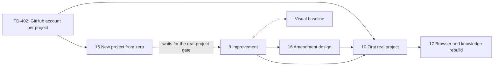

# OwlBear Plan and Status

> **Owning task:** owner request 2026-10-19: one document that grounds any session in what is built, what comes
> next and where the code differs from the decisions
> **Date:** 2026-10-26, status at `main` `8d93c2e54` after #671 and this pull request, decisions to TD-469, item 5's
> decisions of 2026-10-22 and the owner's of 2026-10-23 to 2026-10-26
> **Question:** Where does OwlBear stand, in what order does the remaining work come, and where does the code
> differ from the decisions in force?

Read this first when you start or resume work, and again after a context compaction. The owner's decisions live in
`owlbear-data`, read through [their generated view](../decisions.md) or the decision tools (by topic C-01 to C-31 and
the standalone decisions); how each part is built is in its build document (§6). This file holds only status, order
and gaps. Keep it current as §7 says.

## 1. Status Quo

**Product.** OwlBear Delivery (`serve/delivery-next`, package `owlbear_delivery_next`) is the only Delivery that
runs: one machine host serves every registered project with one UI (Changes, Backlog, Memory, Decisions, Settings,
Maintenance).
The old engine is gone (TD-199, #521 to #524); its source stays at the tag `delivery-v1-final`. The old Cockpit is
gone too (TD-416, #527); the machine UI's pages are the only frontend.

**Use.** No real project uses OwlBear (TD-338); this laptop is the only instance. Two sandbox projects are
registered: `owlbear-sandbox` and `owlbear-sandbox-protected`. OwlBear itself is developed in chat (TD-319 allows
both), through pull requests to `main` with the required `CI` check, strictly up to date, merged as merge commits.

**Runtime.** `~/.owlbear/runtime` is an alias to the active version under `~/.owlbear/versions/`; OwlBear updates
itself to each new tag when idle, or at once with `owlbear update` or Run updates now (TD-415, items 3 and 4). This
laptop updates only when the owner runs it (its own `update_when_idle` off, D-01M5Q5GKHX7BJTXPEW2MHGS9E0).

**Versions.** The release workflow tags labelled merges (`release:minor`, `release:major`) once their push `CI`
passes; the switch `RELEASE_TAGS` is on since 2026-10-19 14:39Z. Tags from `v0.1` exist; v1.0 is the merge of the
pull request that marked item 12 done, tagged `v1.0` and `v1`. The
walk creates tags through the REST API with the owner's fine-grained token `RELEASE_TOKEN` (Contents and Workflows
write, TD-404), since GitHub refuses the workflow token tags on commits whose workflow files differ from every branch
tip; a major gets `vN.0` and `vN` (TD-392). The token expires; the owner renews it.
Renovate's pull requests come back now that the old engine is gone (owner, 2026-10-19).

**Built, by build document:**

| Area | Build document | Pull requests |
| --- | --- | --- |
| The engine and the whole journey, shaping to cleanup, visual check, design pack | [architecture](https://github.com/maba-pag/owlbear-data/blob/main/owlbear/research/delivery-next-architecture.md), [design skill](delivery-next-design-skill.md) | #449 |
| Review and challenge rounds for every role (TD-208, steps 1 to 8) | [challenge rounds](https://github.com/maba-pag/owlbear-data/blob/main/owlbear/research/challenge-rounds-build.md) | #449; steps 6 to 8 as commits before the PR route |
| Pull requests with required CI (TD-278) | [PR, CI, merge queue](https://github.com/maba-pag/owlbear-data/blob/main/owlbear/research/pr-ci-merge-queue-build.md) | #455 to #458 |
| Merge-queue support (TD-226) | [PR, CI, merge queue](https://github.com/maba-pag/owlbear-data/blob/main/owlbear/research/pr-ci-merge-queue-build.md) | commits before the PR route, `0d4272eef` and its repairs |
| Per-role session time limits, doubled (TD-286) | — | #460 |
| Pages on lit-html (TD-264), machine host, one UI, Global memory, SQLite stores, settings across projects | [machine host](https://github.com/maba-pag/owlbear-data/blob/main/owlbear/research/machine-host-build.md) | #461 to #469, #471 |
| Self-update steps 1 to 3b: machine settings, Pause, paused maintenance, PR labels, push CI, release walk | [self-update](https://github.com/maba-pag/owlbear-data/blob/main/owlbear/research/self-update-build.md) | #473, #476, #478, #480 to #482 |
| Test curation of delivery-next (TD-311, TD-312) | — | #477 |
| Decision review TD-319..TD-381: Snyk Code and Renovate, Cyclopts, subagents per role, owner notes as written | the record | #483, #487 to #489, #492, #494, #495 |
| The machine preference layer and session limits (TD-336) | [settings scopes](https://github.com/maba-pag/owlbear-data/blob/main/owlbear/research/settings-scopes-build.md) | #496, #497 |
| The test review from the Maintenance page (C-26) | [test review](https://github.com/maba-pag/owlbear-data/blob/main/owlbear/research/test-review-build.md) | #498, #499 |
| Self-update steps 3c to 5: pack updates through a PR, versions, standby and handover, idle updates | [self-update](https://github.com/maba-pag/owlbear-data/blob/main/owlbear/research/self-update-build.md) | #516 to #520, #525 |
| The old engine's removal in five batches, documentation for v1.0 | [transfer ledger](https://github.com/maba-pag/owlbear-data/blob/main/owlbear/research/delivery-next-transfer-ledger.md) | #521 to #524, #526 |
| Cockpit's memory purge on the Memory page, Cockpit deleted (TD-416) | — | #527 |
| Pages on the design system's CDN only, split into modules under the line limit (TD-39, TD-398, TD-401) | [visual baseline §3.6](delivery-next-visual-baseline.md) | #529, #530 |
| Conflicts with read-back decisions: the agent workspace hidden from Git (TD-420), CI lint from the pre-commit config (TD-409), a repeated finding linked to every match (TD-405) | — | #535 to #537 |
| The decision system (item 14) except the migration: files and validator, Change decisions archived, store with receipts, step context and runner gate, Decisions tab and chat tools, generated view, read-back queue, impact report, fix entries ticked by merged Changes | [decision system](https://github.com/maba-pag/owlbear-data/blob/main/owlbear/research/decision-system-build.md) | #538 to #547, #550 |
| Memory: the residuals of #238, #244 and #249; a chat's memory in its project's folder of `owlbear-data` (TD-72) | — | #548, #553 |
| Decisions as confirmed intent (item 14): inherited decisions, saving at confirmation, the picker and lookups, answers classed by their relayer, the migration and the switch to `owlbear-data` (TD-466) | [decisions as confirmed intent](https://github.com/maba-pag/owlbear-data/blob/main/owlbear/research/decision-intent-build.md) | #556 to #565, #570, #571 |
| Improvement (item 9) slices 1 to 4 and 6's Delivery part: the design, settings and roles, Retro chatlogs, the Spotter's card and learning-mode looks at Delivery steps | [Improvement](improvement-design.md) | #659, #660, #662, #663, #668 |
| The workspace-era installer retired: Delivery's chat server path-free in the root `.mcp.json`, `share/prompts`, `setup/init.py` and `seed/`; `owlbear setup` offers the memory server for the shaper (`D-01M5TYMBBBHQRN172N977ND3VS`) | — | #665 to #667 |
| No generated indexes, Archify diagrams, prompt files or prompt validator: agents find code by search and package READMEs (`D-01M5WA09V20PP0K0HV920FT3Q8`, `D-01M5WG5KH9R31YWK82YDF3RX7W`, `D-01M5WG6AX489EK20815YJECZ7E`) | — | #689, #695 |

## 2. The Plan

The order is the owner's (TD-394): TD-358's build work, the research move, self-update steps 3c to 5, the old
engine's removal, v1.0, TD-318's memory work, the window-step gate, the watcher; TD-403 places the build work of
TD-392..TD-402; TD-338 puts the watcher before any real project. TD-419 puts the decision system next,
before item 5; TD-422 puts the amendment design session before item 10, after the watcher. Item numbers are stable
names, not positions: the table lists the items in their order.

| # | Work | Decided by | Build document | Status |
| --- | --- | --- | --- | --- |
| 1 | TD-358's rest: none; built: TD-328, TD-330, TD-334, TD-335, TD-341, TD-345 (with TD-405, TD-406), TD-347's skill, TD-350, TD-392, TD-396, TD-397, TD-399 (§3.1) | TD-358, TD-403 | TD-330 in [challenge rounds](https://github.com/maba-pag/owlbear-data/blob/main/owlbear/research/challenge-rounds-build.md) §3.4; TD-334 in [machine host](https://github.com/maba-pag/owlbear-data/blob/main/owlbear/research/machine-host-build.md) | Done |
| 6 | Research move: OwlBear's research into `owlbear-data`; the decision record, this plan and build designs of unbuilt work stay (§3.3) | TD-227, TD-347, TD-395, TD-394 | §3.3 | Done |
| 2 | Self-update step 3c: design pack updates through a pull request, with C-15's updater and challenger rules | TD-325, TD-357, TD-368, TD-194, TD-177 | [self-update §8](https://github.com/maba-pag/owlbear-data/blob/main/owlbear/research/self-update-build.md) "Step 3c build" | Done |
| 3 | Self-update step 4: `repo.git`, versions, never backwards, selfcheck, standby, handover, Run updates now | TD-239, TD-299, TD-300, TD-352..TD-354, TD-369 | [self-update §3–§5, §11](https://github.com/maba-pag/owlbear-data/blob/main/owlbear/research/self-update-build.md) | Done (#517 to #519; this machine's first update to v0.20 on 2026-10-20, TD-415) |
| 4 | Self-update step 5: idle, use, announcement, automatic updates | TD-301, TD-288 | [self-update §7, §11](https://github.com/maba-pag/owlbear-data/blob/main/owlbear/research/self-update-build.md) | Done (#520) |
| 7 | Old engine removal: tag `delivery-v1-final`, five dependency-closed batches, three skills retired with batch 3, docs rewritten | TD-199, TD-201, TD-203, TD-394 | [transfer ledger §3.4](https://github.com/maba-pag/owlbear-data/blob/main/owlbear/research/delivery-next-transfer-ledger.md), [cutover §3.3, §3.6, §3.7](https://github.com/maba-pag/owlbear-data/blob/main/owlbear/research/delivery-next-cutover.md) | Done: tag `delivery-v1-final`, batches 1 to 5 (#521 to #524), its issues and pull requests closed, the documentation rewritten for v1.0 (#526) |
| 11 | Pages: the PDS fallback and notice removed, browser tests on the real CDN; then pages, scripts and styles split to the 500-line limit (§3.4) | TD-39, TD-398, TD-401, TD-403 | [visual baseline §3.6](delivery-next-visual-baseline.md) for the removal | Done (#529, #530): the fallback is removed; the pages split into modules under `web/pages/` |
| 13 | Cockpit: audit `serve/cockpit` for what the machine UI lacks (design-system components and workarounds, memory purge, the ideas editor), port what is worth it, delete Cockpit | TD-416 | none | Done (#527): memory purge ported to the Memory page; the ideas editor, theme toggle and workspace health dropped; one lesson for item 11 in [visual baseline §3.6](delivery-next-visual-baseline.md) |
| 12 | v1.0: the first `release:major` merge, tagged `v1.0` and `v1` | TD-393, TD-392 | [self-update §4, §8](https://github.com/maba-pag/owlbear-data/blob/main/owlbear/research/self-update-build.md) | Done: the first `release:major` merge (2026-10-20) |
| 14 | Decision system: decisions as their own system for OwlBear's work and every project, in `owlbear-data`, scoped Change, project and Global; Decisions page with read-backs; impact of a change of mind | TD-419, TD-418, TD-424..TD-430 | [decision system](https://github.com/maba-pag/owlbear-data/blob/main/owlbear/research/decision-system-build.md) | Built: slices 1 to 4 and 5a (#538 to #542: file contract and validator, Change decisions archived, store with receipts and index, step context with the runner's gate, Decisions tab with owner actions and chat tools), 6 (#543: generated `.owlbear/decisions.md`, its hash checked on pull requests and against owlbear-data by `decisions-view.yml`, TD-436) and 5b part 1 (the read-back queue on the Decisions tab, at most three at a checkpoint, `queue_read_back`, and OwlBear's own decisions as a fixed scope, TD-427, TD-435) and 5b part 2 (an impact report per project for a replaced or withdrawn decision, the owner's "forbids existing behaviour" or "wording only" mark, scheduling fixes as grouped backlog entries and accepting a project's existing code, each the owner's click, TD-428). Next: the owner reviewed the migration preview on 2026-10-21 (TD-439 to TD-446), then had decision management rethought end to end and decided it the same day (TD-448 to TD-455): decisions record his confirmed intent only, a lead chat saves at confirmation, workers get the Change's whole picked set while challengers check all, today's rules come over as inherited. A picker on Sol medium picks each Change's rules at shaping and answers lookups; every worker gets the whole picked set (TD-456 to TD-459, from a model test on 13 past pull requests). Next: the six slices of [decisions as confirmed intent](https://github.com/maba-pag/owlbear-data/blob/main/owlbear/research/decision-intent-build.md), the migration being the last; slices 1, 2 and 3 are built (slice 3: a brief's project decisions published in force by its approval, which a failed save refuses; a failed push shown on the Change and sent by the next save; never demoted at its end), and of slice 4 the picker (a brief version's decisions picked before its first challenge, checked and pinned at approval) and the runtime switch (every role of a step gets the pinned picked set plus the Change's own, whole and without a size limit; challengers get the complete list beside it; decisions new since the pick go to the picker in one batch at the next step boundary, a failed pick waiting and retrying; path, role and step selectors removed, TD-460) and the lookup (`lookup_decisions` for a step's own worker, its spend on the Change, and for lead chats through the project host or the machine host's OwlBear mount: the picker over the complete list, a failed lookup reported as failed, TD-456, TD-459) with the agents' boundary in their files (TD-451); slice 4 is complete. Slice 5 is built: the relayer of an answer to a worker's question (a lead chat's `answer_question` or the Changes page) classes it as event, clarification or brief change; a clarification carries the statement the owner confirmed when it was read back, a Sol check on the picker's role compares it with the approved brief, and within it the statement becomes a decision of the Change, in force from that step; a brief change, or a clarification the check finds changing the brief, is never delivered and stops the work with the owner's choice to answer within the brief or stop the Change, until item 16 designs amendments (TD-461). Slice 6 is built: the converter applied `.owlbear/migration/decisions-overlay.json` (130 lines reworded to stand alone after two Sol checks, TD-462; 22 Global by TD-442) and its `REPORT.md` shows each original beside its rewording; the owner reviewed it on 2026-10-22: he checked only the four Sol left uncertain (TD-464), which were split or retired (TD-467 to TD-469); lines of mixed origin carry decided (TD-465); the 28 orphan rows were cited, spent or restored (TD-40), and the quality-service line split by TD-442. The past-work test on the final preview missed nothing new, and the record switched to owlbear-data (TD-466): 22 Global and 324 OwlBear decisions are authoritative there, and the record, converter and overlay are in Git history. Item 14 is complete |
| 5 | After v1.0: project agents and skills off in steps (TD-274's gap); the memory work: curator modes and threshold (95%), moving an entry back, the saver's pre-set, sorting existing project memories once; from the closed memory issues: a test for two writes in the same microsecond (#238), dispute history in the memory tools' answers (#244), the memory handbook's revision parameter (#249) | TD-317, TD-329; TD-292, TD-293, TD-318, TD-400; the session's four of 2026-10-22 (threshold measure, triggers, move back, sort) | [memory work](https://github.com/maba-pag/owlbear-data/blob/main/owlbear/research/memory-work-build.md) | Done (#581 to #588): the saver's recommended scope; Make global records its origin and Move back returns it; steps without discovered or bundled agents and skills; the curator's threshold (global, 95%, Settings page), its tools across folders, `make_global` and its automatic and interactive modes; Delivery's `owlbear-curator` role with Curate now, after-merge and idle runs and a machine setting per trigger, "Curate after merge" and "Curate when idle", each off, on or on even while paused (the owner, 2026-10-23). The one-off sort ran on 2026-10-23 on v1.34: 11 promoted, 6 pruned, 1 made global; the owner settled the 6 it left (3 promoted, one of them split in two; 3 pruned). The three residuals from #238, #244 and #249 are built. R13 (#619, candidate PR #654): a queued automatic run takes its trigger and re-reads pause and the machine switch at its slot grant; Curate now bypasses only those switches, never a fence, and takes over a waiting automatic run without a second run; the curator's subagents setting reaches its session and an unset one never starts; a stop when idle drains the queue, is not bypassable by Curate now, and an already admitted run finishes |
| 8 | Window-step gate: windows keep repository hooks and user MCP servers out, subagents detected and counted, judge effects contained | TD-223, TD-145, TD-342 | [gate build](https://github.com/maba-pag/owlbear-data/blob/main/owlbear/research/window-step-gate-build.md), [probes](https://github.com/maba-pag/owlbear-data/blob/main/owlbear/research/window-step-gate-probes.md) | Retired: window steps are retired as a runtime (D-01M5WG8RGCBKADW6XPGP0E2FAP, 2026-10-26); their code is removed (#698, closing #694; the shaping chat still opens in a window). Before that: TD-267 was built (`ahp.py` on the `websockets` library, #590). The probes of 2026-10-23 settled each part `autonomous` (the owner declined to decide the gate); built: hooks and VS Code MCP servers off per step, the host record's allowlist check, subagents in windows under the SDK rule, read-only steps asking and the SDK policy answering; the live proof of 2026-10-23 held |
| 18 | Settings without code defaults: every setting comes from Global, the machine or the project; unset is an error on the Settings page and the steps needing it ask; today's values carried into Global once; machine settings get a Global layer | D-01M5MYY55ZX0FPN7VZB021H8MC, D-01M5MZKEPWNASF6X3CNF4FEWZH, D-01M5MZKEPW6WCSM8SZ6DH783EN, D-01M5MZKEPPVMFC9HK795MMG91B | none | Done (#604, #605): layered settings, then machine settings with a Global layer, moved there once on this laptop. R15 (#624): foundation merged in #657; final decision-publication composition under review in #656. The five optional preferences (merge method, delete remote branch, CI poll and start window, ask before merge) resolve PROJECT > machine > Global with no code defaults; one-time guarded PROFILE-to-PROJECT import; current CONFIG format 15, PROFILE format 5. A crash after the durable pending claim resumes only when the basis proves the config unchanged and no owner preference action happened; otherwise the import stays pending with a review diagnostic in Settings (not done, no resurrection of cleared or deleted config). A refused publication keeps the owner's review intent in the page until a retry publishes it, so an edited or already-empty clear, or the explicit "Confirm merge preferences reviewed" action, settles the import once the config is published; a losing concurrent importer resumes only from the durable winning claim and never creates config. The fill stays bound to the remote's config and claim through every push and rebase of its checkout, by a record in that checkout's Git folder. A mismatched or unprovable push remote, ref or complete address is held rather than redirected. A remote that settled or cleared the claim meanwhile holds the checkout with a notice; retirement requires the full unpushed history to contain no change of that config and the index and working copy to match HEAD. Matching remote bytes, a merge or an unpushed revert do not remove a replayable fill. A damaged or unreadable hold, including a dangling link, refuses publication and pull rather than counting as no hold. The owner must resolve the unpushed commits; nothing in Git is undone automatically |
| 19 | Pinned OwlBear: live chats keep their tools across updates; the chat server a state-free client of the host under a chat contract (first), then the memory, knowledge and browser servers run from the install, pinned and leased; this laptop updates only deliberately | D-01M5Q5GKHX7BJTXPEW2MHGS9E0, D-01M5Q5GKBFGSJRGCPXET234QAH | none | Built: the chat contract (#632, v1.49), the launcher (#636, v1.50) and the memory, knowledge and browser entries of `.mcp.json` and the seed switched to it (#638); item 9 next |
| 9 | Improvement (formerly the watcher): tool and contract fixes and the Primer first, then the Spotter (Delivery steps and enrolled chats) with its records and cases, then Retro (after-task hindsight analysis) and the Improvement page; each finding gets its category's configured action, irreversible harm acting at once and discretionary steering only after a steered-versus-silent test; built complete before item 10 | TD-224, TD-316, TD-47, the owner's choices of 2026-10-25 | [Improvement](improvement-design.md) | Redesigned 2026-10-25, twice. Built: W1a (#640), the SDK feed and agent identity, which the Spotter reuses. Closed: #647 (a shell-effect parser). Phase 1a built: changed_paths derived, limit errors, check-form hint. The Primer built: lessons in every new step conversation (#653). A pilot and a hindsight review of 83 real moments found the only candidates for a note at hand-offs and fresh instructions, never mid-flow; their value is unproven. The design's slices: built the target design (#660), settings and roles (#662), Retro chatlogs (#663) and the Spotter's core: the card and looks in learning mode at Delivery steps' hand-offs and samples, recorded on this machine (#668). Follow-ups of #668 (2026-10-26): a live test of one look (it found that the runtime refuses a session credit cap under 30, so a look sets none, D-01M5W0HKR9RBAF3G4H8BTZS8E0, #682; a real look then worked), `mask.py` in linear time (#680), the chat server trusting the machine registry (#681); the old watcher decisions settled with the owner (§3.5); the Spotter's on/off switch and its action per category of finding, checked against the allowed set (D-01M5WP8Z4ADZ5FN7RJDR17RQQ5) and recorded with each look, nothing acting yet (#697); the window-step code removed (#698). Next: Spotter cases, the chats follower, Retro, the Improvement page, live delivery, then item 16, then item 10 (§3.5) |
| 16 | Amendment design session with the owner (TD-185), end to end, before any amendment code | TD-185, TD-422 | none yet | Not started |
| 10 | First real project: the per-project GitHub account setting first; memory publication and curation (F17) fixed; two Changes merged in consumer projects; OwlBear builds itself through Delivery | TD-338, TD-402, TD-90, TD-319 | none yet | Waits for item 9 |
| 17 | Browser and knowledge rebuilt from scratch, from the [ideas of the closed issues](https://github.com/maba-pag/owlbear-data/blob/main/owlbear/research/closed-issue-ideas-2026-10.md); until then the packages stay untouched | TD-434 | none yet | After item 10 |
| 20 | Audits as Maintenance actions: agent-audit for OwlBear, doc-audit also for consumer projects; the two skills then go | `D-01M5WG5KHAXT8P99VXHKWW5EBJ` | none yet | Not started |

**Not yet placed** (decided or planned, no position in the order):

- Visual baseline: "before" captured in shaping, retake, preview ports (TD-38, TD-40); its PDS part is item 11. The
  repair plan of 2026-10-11 put it after the watcher, because its live proof needs a runtime the owner can follow.
  [Plan](delivery-next-visual-baseline.md), nothing built.
- The amendment design (TD-185) is item 16 now (TD-422).
- New project from zero (TD-421, TD-431..TD-433, item 15): [design](new-project-build.md), answered by the owner;
  it pulls TD-402's per-project GitHub account forward; a project created this way waits for the real-project gate (D-01M5WECJV6B3MWJ44C4C0SEJ3B).
- The quality service (TD-89): [research](https://github.com/maba-pag/owlbear-data/blob/main/owlbear/research/repo-quality-service.md), not built.
- Contradicting findings of the two visual judges go to the owner ([design skill §3.5](delivery-next-design-skill.md));
  they are not detected (§3.7 there).
- An organisation with the merge queue for OwlBear's `main`, once someone else contributes or Delivery builds
  OwlBear (TD-326).
- The "align" fixes of §4 that belong to no item above: small, each its own pull request.

**What depends on what** (open work only; solid: needed first, dashed: decided order without a technical need):

Independent of everything else: TD-402 (small, before item 15), the align fixes of §4 and the quality service.
Renovate's #452 merged on 2026-10-22: Renovate now raises `package.json`'s Node floor with `.nvmrc`. Item 14's
runner gate only stops and asks until item 16 designs amendments; its CI freshness check (slice 6) runs with the
owner's `OWLBEAR_DATA_TOKEN` secret (TD-436).

**The old roadmap.** The roadmap M0–M7 and the repair plan of 2026-10-11 are history at `04b1d8ec4` (§3.7 and §3.12
of the old record). Older documents still name their milestones: M0 to M4 are done (M4 is #449 and what followed);
E1 is part of item 7; M5 is item 10; M6 is item 7; M7's size and style rules are C-28. The repair plan's phases 1
and 2 are done, phase 3 is item 9, phase 4 is the visual baseline, phase 5 was replaced by the runtime design, and
of phase 6 the collision rule (C3, TD-12) is built and the change of mind (C5) is the amendment design.

## 3. Next Steps in Detail

### 3.1 Item 1: TD-358's remaining build work and TD-403's small items

TD-358 ("All of it now, before self-update step 3b") was recorded after step 3b had merged (#481), so it is read as
"before the rest of the self-update"; TD-394 confirms it comes first. The audit of §4 found the eight below unbuilt;
the range's other rows are built, history, or part of steps 3c and 4 (TD-325, TD-352, TD-353, TD-357). TD-403 adds
the small items of 2026-10-19. Built since: TD-392 (#502), TD-328, TD-341, TD-347's skill, TD-396, TD-397 and TD-399,
with the C-02 catalogue text (#506), TD-345 with TD-405 and TD-406 (#508), TD-350 (#509), TD-335 (#510), TD-330
(#511) and TD-334: item 1 is done. TD-334 moves a store still in the clone into `~/.owlbear/projects/<id>` on its
first open; the clone keeps its id and a format marker that every older runtime refuses.

### 3.2 Items 2 to 4: the self-update

Item 2, [self-update §8](https://github.com/maba-pag/owlbear-data/blob/main/owlbear/research/self-update-build.md) "Step 3c build", is built. A pack update commits on `pack/<run>`
from a clean checkout of `main`, opens a labelled pull request, waits for the required checks, brings the branch up to
date and merges it; whatever stops it asks the owner, and a host restart during publication waits for him instead of
failing. In line with C-15 the updater may change the pinned skills, the golden pages and the detector's glue; anything
else, changed expected evidence, a change the challenger is unsure the upgrade needs and a glue change go to the owner,
the glue checked with the running code (TD-414); the challenger judges every changed file. Steps 4 and 5 are §3–§5 and
§7 there.

### 3.3 Items 6 and 7: research moved, then (after the self-update) the old engine

The research moved on 2026-10-20: 1,156 documents went to `owlbear-data/owlbear/research/`, with a README there that
says how their relative links resolve. Here stay this plan and the build designs of work not
yet built (TD-395): design skill (judge conflicts), visual baseline, watcher design and options. A design moves
there once its work is built; the transfer ledger and cutover followed with item 7, the self-update and PR/CI/merge
queue designs with v1.0. Links from what stays point at the moved
documents' GitHub pages. Agents write research to the project's folder in the data repository (`w-research` Step 6,
`r-workspace-governance`), OwlBear's included; `.owlbear/research/` takes only the plan and new build
designs. The old engine's designer went with batch 3 of item 7.

The removal follows the self-update (TD-394) and the ledger's batches 1 to 5 (the
`main` sync batch is gone, TD-203) with the tag first; its precondition for batch 2 (the new Changes page reachable)
holds. It rewrites the documentation v1.0 needs (TD-393). The old engine's issues #225 and #400 and pull requests #405
and #412 closed with it; Renovate's pull requests come back after it. Batch 5 also retired the
four seeded hooks only the old agents registered; `deny-src-writes.py` and the `.owlbear/hooks/` wiring went with the
shared `test-curator` and `memory-curator` agents, which Delivery's own curators replaced. The old live state
(`.owlbear/delivery/`, `.owlbear/controller/`) stays on disk until D5's endpoint, two consumer Changes merged on the
new engine (item 10).

### 3.4 Items 11 and 12: pages, then v1.0

The PDS fallback is gone as the [visual-baseline plan §3.6](delivery-next-visual-baseline.md) lists: the 3-second
decision, the `pds` flag, every native-control branch, the `.no-pds` CSS and its notice; the confirmation and the
screenshot viewer are `p-modal`s, and the browser tests let `cdn.ui.porsche.com` through instead of aborting it
(TD-398). The module test now counts every page, script and style the package owns, the vendored `web/vendor/` and
`web/pds/` aside (TD-401), and the three large pages split by section: each keeps its markup and styles, and its
script became ES modules under `web/pages/<page>/`, served from a list fixed at startup as `/assets/page/<page>/<name>`.
`changes.html` went from 1496 lines to 128, `config.html` from 1102 to 39, `backlog.html` from 524 to 55; no module
has more than 259.
v1.0 is the first merge labelled `release:major`, after items 1, 6, 2, 3, 4, 7, 11 and 13; it is tagged `v1.0` and `v1`.
Item 14, the decision system (TD-419), is built (#538 to #547); the owner reviewed the migration preview (TD-439 to
TD-446), then had decision management rethought and decided it (TD-448 to TD-462, [design](https://github.com/maba-pag/owlbear-data/blob/main/owlbear/research/decision-intent-build.md)).
Its slices 1 to 5 are built (#556 to #565); slice 6 is done: the owner reviewed the preview (TD-464 to TD-469), the
final preview passed the past-work test, and the record switched to `owlbear-data` (TD-466); the record and its
converter are Git history. Item 5's three
residuals from closed issues are built (#548); the rest of item 5 needs a design.

### 3.5 Items 8 and 9: gate, then Improvement

*History, superseded by the cleanup of 2026-10-26 below (window steps retired, the rethinker dropped):* the gate has a [build design](https://github.com/maba-pag/owlbear-data/blob/main/owlbear/research/window-step-gate-build.md) in five slices, from the probes of 2026-10-23; the owner stated
that its criteria were agent proposals he accepted without intent of his own and declined to decide it, so its choices
are `autonomous`. The watcher's [draft](https://github.com/maba-pag/owlbear-data/blob/main/owlbear/research/delivery-next-watcher-design.md) is revised to TD-55 and TD-365 (no guard blocks
outside writes; the watcher judges each one afterwards, stops the dangerous or inappropriate and reports the harmless),
to the gate as built, and to the window steps staying paused: it is built for SDK steps first. Its §4 asks the owner
three questions and proposes the rest as `autonomous` drafts; heads-ups were answered on 2026-10-23: a separate
"rethinker" agent on a stronger model, not the watcher.
The owner's input of 2026-10-21, Claude Code's "You should know" observer, is its §3.4b.

**Redesign of 2026-10-25.** The owner's goal for the watcher is improving agents, skills and tools, not catching
outside writes; malicious calls are out of scope for now. He first chose a live coach that looks when progress
stalls. A pilot on real moments, then a hindsight review of 83 of them (what happened afterwards, from the full logs),
found that the only candidates for a note sat at hand-offs or right after a fresh instruction, never mid-flow; that
no log shows what steering costs; and that even those candidates are not proven worth an interruption. He then chose [Improvement](improvement-design.md), with new names:
- first, tool and contract fixes and the **Primer** (lessons at session start), both built;
- **Retro**, an after-task analysis of whole tasks with hindsight, run by the machine host, that grades the Spotter
  and proposes lessons and fixes, on an **Improvement** page;
- the **Spotter**, synchronous beside working agents (Delivery steps and enrolled chats), in learning mode first,
  recording what it would do; live only after a steered-versus-silent test on real tasks shows a gain.

He then chose to build it complete, chats included, before item 10: the machinery does not depend on real-work data;
rules, cases and thresholds are content the Spotter follows.

The owner's choices of 2026-10-25 and 2026-10-26 are recorded: the Spotter in shadow at hand-offs graded by Retro
(D-01M5VXXFBX7B91HMQMWE57XRNB), the names (D-01M5VXXFC06CSNK0ANS14E1WX2), built complete before item 10
(D-01M5VXXFC0G5Y5HMAS82GTMYRH), machine values read from `state_store` (D-01M5VXXFC28ZFHV7HVDTKFHPVF) and no credential
masking in the Spotter's own cards and records (D-01M5VXXFBSWVZ0DZ68G1QG4CYG); a look sets no SDK credit cap
(D-01M5W0HKR9RBAF3G4H8BTZS8E0). The old watcher decisions were settled the same day, one question at a time
(design §4 to §6 hold the result): an on/off switch and an action per category of finding replace the mode
(D-01M5WB09Z3ZKJVN02WGWVHGWBH, replacing TD-55's stop and retry; the settings D-01M5WBAFQPZT6QBMV3V3HZ83ES); the
Spotter judges what is irreversible harm (D-01M5W6NGXW27VW024E1B29W3GA) and outside writes (D-01M5W68MMV8JCVKNKH4VJQ9V14,
replacing TD-365; D-01M5W7C4R6M99MVWHR8X1GMCBT); asking the owner (D-01M5WB8V8ZRGZWWVS9K2CV209E); every runtime used
readable, steerable and stoppable (D-01M5W9YB6VHT7RW53M3133WD3C); a display switch for the Spotter's and Retro's detail
on a Change (D-01M5W9AEB412SNWYM2CS27H68M) and the Improvement page's lists and follow-up work
(D-01M5W9AE1G5T7B5NY998CASAJ9); Retro's lessons and fixes (D-01M5WAK48NRE79JZFAHDGWS4DA,
D-01M5WC085F34Y2RVPXFC3ZX53C) and its marks for a possible periodic look (D-01M5WBKHD13WNNR1C7PJ6FV6NT; the rethinker
dropped); a step's stage from Delivery's events (D-01M5WCF6TRXZD7MJG0HEZ4F482); the real-project gate: Improvement
complete, the Spotter on and irreversible harm acting (D-01M5WDN137VPY3W8N0QAJ75KMZ); window steps retired
(D-01M5WG8RGCBKADW6XPGP0E2FAP, code removed in #698). The benchmark decision and the duplicates are retired.

**Built (2026-10-26).** Slices 1 to 4, the Delivery part of slice 6 and the category settings (#659, #660, #662, #663,
#668, #697): while the Spotter is on, a Delivery step's hand-offs, and a sample of its actions if chosen, get a look
whose finding's category and configured action are recorded on this machine; nothing is sent or acted on. While the
switch is on, a step needs the Spotter's required settings (the four category actions, `steer_share`,
`intervention_cap`, `verbose`, `looks`, and `sample_rate` when `sample` is a look), the `spotter` role and the
machine's `spotter_budget`; an unset switch blocks too, and off needs nothing. Global has the switch on with the four
actions "record" (migrated from `learning`) while the other Spotter settings and the budget are unset, so the owner
fills them in on the Settings page, or switches the Spotter off, before Delivery runs a step again.

**Next steps, in order:**
1. The rest of #668's follow-ups. Done on 2026-10-26: a live look against the real runtime (it found the credit cap
   the runtime refuses, removed in #682; then a real hand-off look gave a correct note for 0.07 credits in 7.5 s),
   `mask.py` in linear time (#680), the chat server never taking a clone id the registry does not list (#681).
   The old watcher decisions are settled (above). The settings slice is built (#697): the on/off switch and the four
   category actions replace `mode`, each action checked against the allowed set (D-01M5WP8Z4ADZ5FN7RJDR17RQQ5); a
   former `learning` became on with every action "record". The window-step code is removed (#698). The owner sets
   the Spotter's remaining settings, or switches it off; until then Delivery steps wait for them.
2. Spotter cases (slice 5's rest): records become candidate cases, stages, versions, a holdout and the regression,
   seeded from the pilot's moments with their hindsight verdicts.
3. The chats follower (slice 6's rest): the machine host tails each enrolled chat's `events.jsonl` and looks at its
   hand-offs and plans.
4. Retro (slice 7): the machine-host job over whole Changes and finished chats, grading the Spotter's records and
   proposing cases, lessons and fixes, reviewed by `retro-review`.
5. The Improvement page (slice 8): the Spotter, Retro, cases and proposals managed by direction.
6. Live delivery and the steered-versus-silent test (slice 9), only once Retro's grades are high enough.
7. Item 16, the amendment design session with the owner (TD-422: after Improvement, before item 10).
8. Item 10, the first real project.

## 4. Where the Code Differs From the Decisions

Audit of every in-force line of the record against `main` `23bd7c1ab` on 2026-10-19 (eight read-only reviews,
key gaps confirmed in the code), updated for the owner's answers TD-392..TD-403 the same day and rechecked on
2026-10-21 after #535 to #553. Only gaps are listed;
every other line is built as decided. Action: **align** the code to the decision, **build** planned work, **keep**
as is for the reason given. Item: the plan item of §2 that picks it up.

That earlier alignment pass is not a correctness certification. The
[implementation audit of 2026-10-24](https://github.com/maba-pag/owlbear-data/blob/94e36035c625af211d57fc61b8a7fe4ae6927e09/owlbear/research/delivery-implementation-audit-2026-10-24/README.md)
found 26 supported defects at `ebf7bbbeb`, grouped into 21 repair packages under
[#606](https://github.com/maba-pag/owlbear/issues/606). Their issues hold current repair
and verification status; #605 was not part of that baseline. The decision-page scope
repair (#607) binds displayed decisions, confirmations and mutations to the same
captured scope and rejects superseded responses. Cleanup preservation (#610) keeps
unsupported nested repositories and entries in their workspace instead of omitting
them from a verified archive; supported links and file modes are preserved without
following symlink parents. Decision publication (#613, R06), under review in #656, uses an interrupted-batch journal
and explicit generation-bound Finish/Abandon; authority reads refuse active or unknown rebases as well as an unsettled
batch. Publication retains the operation's own commit and captured repository destination. After a successful file
installation, the former temporary name is no longer owned and is never cleaned up on a later durability failure.
The R15 foundation in #657 remains incomplete until this actual shared-publication composition is verified and merged.

The owner-continuation candidate (#618, R12) sends a
replacement check session the owner's pending answer before its delivery is recorded,
and keeps an accepted held result until its final write is durable, so a restart
applies it once without a paid rerun. An accepted review's round and findings are
buffered until that final write. A held result is written to its hold file first, with its full run, usage, tool
accounting and step label; it is counted once through a receipt written with the spend, and a restart with an
uncounted hold counts it before any step runs. When the hold file cannot be written, the Change keeps the same held
record (format 8), so the owner's accept and the count survive without a paid rerun; if the Change write fails too,
the error is reported and nothing is counted. A hold written before this receipt existed is marked unread once,
never zero-filled or recharged. An accepted fallback is cleared from the Change once its result is durable, so it
cannot suppress a later step; a failed clear is retried by the next run without a session or a second count. A
declined or stale hold is retired durably, its fallback with it, before anything runs in its place, so a HEAD that
returns never revives it; a later hold is never removed with it. A count that failed after its hold was written goes
on the latest folded Change: the owner's pause, abandon or new brief stays, and the hold's gate comes back only while
its step and brief still fit. Held runs and pending child runs with unknown fields are refused, never rewritten. An
accepted parent that starts a paid child (the plan challenge, an amendment challenge) first writes its checkpoint
with the hold's receipt; the child's validated run is kept on the Change as soon as it returns (in a capture file the
next run adopts when that write fails) and counts once, in
the write that settles its verdict, so a failed settlement resumes from it without a second session. A child whose
step the owner has left counts once without routing it; a paused one waits for its step. A wrong-model or failed
challenger judges nothing and reruns alone, as does an unread one the owner retries. The
branch carries main's #653 lesson delivery and exposure logging, which runs after the replacement check's send and
before its delivery is recorded. Other packages remain open until their own merged-code
acceptance evidence is verified.

Remote-branch retirement (#612) uses an atomic expected-head ref update, never
name-only deletion. Advanced or recreated heads stay intact; Change cleanup asks
to keep that head and finish or pause, and pack updates log retained or uncertain
cleanup without losing a proven merge. Lost acknowledgements are read back before
any guarded retry.
The cleanup decision's Pause holds across restart until Resume; Keep preserves
abandonment mode. An ordinary pause still permits cleanup.
The Changes page keeps Resume available until the Change actually finishes,
including a cleanup whose displayed stage is already Done or Abandoned.

Nonterminal queue readbacks wait without creating a permanent delivery discrepancy.
The GitHub provider validates the base repository in each read/create response
instead of relabelling an unchecked response with the requested repository.
Terminal PR delivery (#614) is checked against the Change's repository, PR number,
own branch and stored integration target, not a default branch convention. A
persisted discrepancy holds across unavailable PR reads, including Pause then
Resume; person-only checks cannot settle or relaunch past it. A different
delivery asks the owner to pause or abandon without fulfillment; its
work is preserved against the intended target, fixes and curation get no success
credit, and the observed other PR is recorded separately from delivery evidence.
Lost-runner accounting cannot replace that terminal owner disposition with a retry.

SDK cleanup (#611) owns the client across startup, usage and proof, and completes
its bounded teardown before propagating the original error or cancellation.
Journal failures cannot skip disconnect, stop or force fallback; failed cleanup
stays unconfirmed, so a known orphan cannot authorize a successor.

SDK result deadlines (#627) close acceptance before helpers and after validation
and synchronous recording, and bound active snapshot/reminder RPCs by the remaining result budget
without waiting for cancellation cooperation. Outstanding request tasks stay owned
through teardown; pending requests cannot produce confirmed termination. The budget
still starts at wait entry, without changing startup or cumulative-resume policy.
SDK session callers bound cancellation of leftover asynchronous requests without
losing returned usage or payloads. Synchronous tools retain their caller's ownership
until executor work settles; cancelled waiters neither release running tools nor
permit queued tools to start later. Unknown shutdown remains unconfirmed.
Returned snapshot PIDs are recorded inside the owned request even after the
acceptance cutoff. Teardown list, cancel, disconnect and stop requests also use
cancellation-independent bounded waits, so one resistant RPC cannot skip later
cleanup or hide an unresolved session.

Decision lookup (#616) fails closed for any unresolved in-scope authority, even
beside valid rules: worker and lead-chat replies name the unresolved rules and
reasons without a governing answer or picker run. The full binding wording kept
by a shortened archived statement reaches shaping and boundary picks, lookup
replies, pinned baselines and step input through one shared representation.
Long answers and literal terminal ellipses use a versioned escaped frame that
keeps binding text separate from reasons, literal headings and later action notes.
Unframed legacy ellipsis-plus-wording records are indistinguishable from quoted
reasons and block before a picker or baseline is built. Original approved-answer
replay may add framing without rewriting accepted IDs or canonical statements;
otherwise confirmed replacement resolves them. Origin correction validates first.
Repair (R10 review): promote, withdraw and origin correction on an
unreadable rule return a 409 that names it and writes nothing; a saved pick of
such a rule is refused before its baseline is pinned; pinned baselines store the
whole wording; an unusable inherited frame yields no new binding, and a blank
replacement reason stays a 422 until the owner decides whether a damaged frame
may be replaced without a fresh reason. Wording provenance follows the
producer-set source, not rationale text: a supplied frame in a proposal or
replacement reason stays a note, promotion of an ordinary answer is framed with
its whole statement, and an archived replacement with a literal ellipsis is
read as canonical. A readable legacy managed archive whose statement ends in a
literal ellipsis is framed before any note is appended, even when its whole
wording equals the canonical statement, so promotion and origin correction keep
one unambiguous rule.

Shared-settings publication (#622) distinguishes a missing path from failed Git
tracking or staged-diff probes and stops before acknowledging a failed commit.
Pending-status failures are reported instead of reading as fully published;
unchanged saves still retry prior commits without consuming unrelated staging.

Profile provenance (#615) binds confirmed intent to the complete observation,
including its state and value, rather than an evidence label. Push permission,
hooks and install facts remain in each clone's local overlay; repeated reads
cannot borrow another clone's capabilities. Legacy facts are observed once,
publication failures keep local progress without file/index undo, and new Changes
use the current target while existing Changes retain their stored target.
Confirmation retains the raw workflow digest without nesting its evidence label,
so owner-selected CI checks still govern the same workflows. A returned publication
failure notice leaves detection incomplete and retryable, just like a raised failure.
Profile pairs use their writer lock; detection preserves newer local edits and
clears per key, retains unchanged fresh capabilities, and retries before acknowledging
a raced snapshot. Explicit install commands for undetected packages bind to the same
absence observation on confirmation and refresh.
Readers take the same pair lock, with an internal unlocked reader for the guarded
save, so neither shared nor unshared reads combine halves across saves. A missing
private profile remains a read-only absence; lock failures are reported.

Brief approval (#617) rejects blank required decision wording and refuses the
whole approval if any current ID-bearing project rule cannot be built or saved.
It never publishes a valid subset or acknowledges project rules without shared
storage; genuinely legacy ID-less records retain their compatibility path.
Malformed, never-published historical rows do not block a corrected version;
their stored history stays intact and published predecessors still retire.

Read-back consent (#626) keeps normalized settled-reason identities in the
portable decision file across later reasons and host reloads, without changing
the rule revision. Ignoring or leaving a reason pending is not consent.
Origin-only correction preserves the same rule's history; new rules start fresh.

Change creation (#609) allocates handles, slugs and new records across processes in
one transaction. Maintenance test-review setup reserves its identity before Git
work, retains it after failed setup, and publishes only into its own reservation.

Installed pack-update preflight (#621) captures origin's main commit before
fetching that exact object, without a normal-clone tracking ref or shared
FETCH_HEAD. Detached installed versions on main stay valid; dirty, off-main,
wrong-identity and failed-fetch sources still refuse without checkout changes.

Maintenance errors (#625) keep mutation refusals separate from read failures.
Successful refreshes do not acknowledge failed actions; only dismissal or a
relevant successful action does, with curation refusals retained per folder.
Failed reads keep the last good data with an explicit error and retry; an initial
missing clone-host curation route remains capability absence. Superseded refreshes
cannot overwrite a newer result.

Integration collision consent (#620) runs on the supported integration BUILD task.
Its durable task base survives restart and owner choices resume that task. Every
new planner result advances the plan generation; consent binds to that task, the
actual merge sides, paths and behaviours, never a pause answer. Termination stops
retain their recovery action. Every relevant merge since the durable base is
checked, so a later clean update cannot hide an earlier collision; a resolved
subset retains the consent given to its pending merge. Durable task progress
keeps a missing base stopped even after owner continuation clears Step markers.
Missing bases or failed Git probes stop
instead of passing; conflict paths retain whitespace without Git quoting losses.

| Line | Decision | Code today | Action | Item |
| --- | --- | --- | --- | --- |
| C-04 | The Spotter reads, steers and stops every runtime used; one that cannot is not used (D-01M5W9YB6VHT7RW53M3133WD3C) | SDK steps read; the Spotter records each finding's category and configured action (#668, #697); steering, refusing and stopping not built | build | 9 |
| C-04 | A guard denial never leads to more tools; a window-only tool is asked of the owner, naming it, never run elsewhere (D-01M5WG7TB1292KJ05CH0R11WE0) | Asked of the owner | keep | — |
| C-11 | Shaping captures the target pages; approval waits for them (TD-38) | "Before" is taken at the check | build | visual baseline |
| C-11 | A target whose UI changed since shaping gets a retake | Partly | build | visual baseline |
| C-14 | Bounded delegation, the "weaker" rule, the amendment process, fields and baseline | Partly; blocked by the open design TD-185 | keep | not placed |
| C-16 | OwlBear's own project sets `release:minor` | OwlBear is not a registered project | keep | 10 |
| C-19 | Add project can create a new project from zero (TD-421) | Only an existing clone can be added | build | 15 |
| C-20 | OwlBear builds itself through its own Delivery (TD-319) | Developed in chat only | keep | 10 |
| C-25 | Retro proposes lessons and fixes (D-01M5WAK48NRE79JZFAHDGWS4DA) | Not built | build | 9 |
| C-27 | A step's stage comes from Delivery's events, without a model (D-01M5WCF6TRXZD7MJG0HEZ4F482) | Not built | build | not placed |
| C-26 | Tests do not assert prose wording | Two memory-governance tests still assert curation wording (identity deferral, corroborated scope): kept until a behavioural test covers the rule | align | — |
| C-28 | Tool use is measured, success rates included (T8) | Counted per Change and shown on its page (TD-463); no view across Changes, and wrong-tool selection shows only as missing-tool reports | align | — |
| C-28 | Default rules guide, never gate | Ruff's complexity rule fails CI; `noqa` is the escape | keep | — |
| S | A project setting names the account for GitHub writes, by default the owner's when `gh` has it (TD-402) | `maba-pag` does everything; both sandboxes are `boecht`'s | build | 10 |
| S | A quality service runs linters and judges exceptions (TD-89) | Not built | build | not placed |

Record repairs made with this document: the trim of 2026-10-19 had listed TD-228, TD-250 and TD-358 as spent,
dropped C-21's lines for TD-199 and TD-201 and cut TD-318's schedule to one of its four parts; they are back in force.

## 5. Open Questions for the Owner

Ask each with the question tool in the owner's format (workspace instructions, "Asking the Owner"). Answered on
2026-10-19 as TD-392..TD-403: the v1.0 tags and timing, the order of the remaining work, which saves confirm, the
test review while paused, the research move's timing and scope, the PDS fallback, which roles save memory, the
curator's threshold, what the line limit covers and the GitHub account. Answered on 2026-10-20 as TD-417..TD-438:
the step-kind cap, the recording rule and the decision system, the agent workspace, a new project from zero, the
amendment session's timing, the browser and knowledge rebuild; on 2026-10-21 as TD-439..TD-455: the migration
preview, CodeRabbit, and decisions as confirmed intent.

1. None open.

## 6. Documents

Links to GitHub pages point into `owlbear-data/owlbear/research/`, where the built designs and the research live
since item 6; the others are in this folder.

| Document | Role | Status |
| --- | --- | --- |
| [Decisions](../decisions.md) | The generated view of the owner's decisions in `owlbear-data` | Current; the decisions are the authority for intent |
| This file | Status, order, gaps, open questions | Current |
| [Self-update](https://github.com/maba-pag/owlbear-data/blob/main/owlbear/research/self-update-build.md) | Build design of items 2 to 4 and the v1.0 tags | Built (steps 1 to 5, v1.0) |
| [Settings scopes](https://github.com/maba-pag/owlbear-data/blob/main/owlbear/research/settings-scopes-build.md) | Machine layer and session limits | Built (#496, #497) |
| [Test review](https://github.com/maba-pag/owlbear-data/blob/main/owlbear/research/test-review-build.md) | C-26's test review | Built (#499) |
| [Machine host](https://github.com/maba-pag/owlbear-data/blob/main/owlbear/research/machine-host-build.md) | One host, one UI, SQLite, settings scopes | Built |
| [PR, CI, merge queue](https://github.com/maba-pag/owlbear-data/blob/main/owlbear/research/pr-ci-merge-queue-build.md) | Pull request route and queue support | Built; its pack route with item 2 |
| [Challenge rounds](https://github.com/maba-pag/owlbear-data/blob/main/owlbear/research/challenge-rounds-build.md) | Review and challenge loops | Built |
| [Design skill](delivery-next-design-skill.md) | Design pack and screenshot judges | Built; contradicting findings not detected |
| [Visual baseline](delivery-next-visual-baseline.md) | TD-38 to TD-40 | Plan; its PDS part (§3.6) built with item 11, the rest not built and not placed |
| [Decision system](https://github.com/maba-pag/owlbear-data/blob/main/owlbear/research/decision-system-build.md) | Item 14 | Built (#538 to #547, #550); its migration replaced by the next row |
| [Decisions as confirmed intent](https://github.com/maba-pag/owlbear-data/blob/main/owlbear/research/decision-intent-build.md) | Item 14: TD-448..TD-462 | Built (#556 to #565); the migration reviewed by the owner (TD-464..TD-469) and the switch done (#570, #571, TD-466) |
| [Memory work](https://github.com/maba-pag/owlbear-data/blob/main/owlbear/research/memory-work-build.md) | Item 5 | Built (#581 to #588) |
| [New project from zero](new-project-build.md) | Item 15 | Designed; not built, not placed |
| [Improvement](improvement-design.md) | Improvement (formerly the watcher), chosen 2026-10-25 | Building: slices 1 to 4 and 6's Delivery part built (#659 to #668); the [earlier draft](https://github.com/maba-pag/owlbear-data/blob/main/owlbear/research/delivery-next-watcher-design.md) and its [options](https://github.com/maba-pag/owlbear-data/blob/main/owlbear/research/delivery-next-watcher-options.md) are history |
| [Transfer ledger](https://github.com/maba-pag/owlbear-data/blob/main/owlbear/research/delivery-next-transfer-ledger.md) | What the old engine leaves; the deletion batches | Built (item 7) |
| [Cutover](https://github.com/maba-pag/owlbear-data/blob/main/owlbear/research/delivery-next-cutover.md) | D5: coexistence, E1, deletion list, docs list | Built (item 7), as TD-199 and TD-203 changed it |
| [Quality service](https://github.com/maba-pag/owlbear-data/blob/main/owlbear/research/repo-quality-service.md) | TD-89's service | Research; not built |
| [Charter](https://github.com/maba-pag/owlbear-data/blob/main/owlbear/research/delivery-next-charter.md) | The approved charter of 2026-10-10 | In force only where no later decision replaced it (TD-23); the decisions win |
| [Architecture](https://github.com/maba-pag/owlbear-data/blob/main/owlbear/research/delivery-next-architecture.md), [status and exits](https://github.com/maba-pag/owlbear-data/blob/main/owlbear/research/delivery-next-status-and-exits.md), [journey](https://github.com/maba-pag/owlbear-data/blob/main/owlbear/research/delivery-next-journey-and-failure-modes.md), [glossary](https://github.com/maba-pag/owlbear-data/blob/main/owlbear/research/delivery-next-glossary.md) | The design of 2026-10-10..14 | History; the decisions and the code win |
| [Ownership map](https://github.com/maba-pag/owlbear-data/blob/main/owlbear/research/delivery-next-ownership-map.md), [route comparison](https://github.com/maba-pag/owlbear-data/blob/main/owlbear/research/delivery-next-route-comparison.md), [platform probe](https://github.com/maba-pag/owlbear-data/blob/main/owlbear/research/delivery-next-platform-probe.md), [agent runtime](https://github.com/maba-pag/owlbear-data/blob/main/owlbear/research/delivery-next-agent-runtime.md), [tool surface](https://github.com/maba-pag/owlbear-data/blob/main/owlbear/research/delivery-tool-surface-audit.md), [reuse study](https://github.com/maba-pag/owlbear-data/blob/main/owlbear/research/delivery-next-reuse-study-v2.md), [agents from old](https://github.com/maba-pag/owlbear-data/blob/main/owlbear/research/delivery-next-agents-from-old.md), [ECC](https://github.com/maba-pag/owlbear-data/blob/main/owlbear/research/ecc-evaluation.md) | Research behind the design | History |
| [Redesign execution plan](https://github.com/maba-pag/owlbear-data/blob/main/owlbear/research/delivery-redesign-execution-plan.md) | The old engine's programme | Superseded (TD-202); history |
| Old record at `04b1d8ec4` | Every decision row as first recorded; roadmap M0–M7; repair plan | History: `git show 04b1d8ec4:.owlbear/research/delivery-liveness-first-rebuild.md` |
| Last record at `58f7f40ae` | The record as migrated, with the owner's quotes | History: `git show 58f7f40ae:.owlbear/research/delivery-liveness-first-rebuild.md` |

## 7. Keeping This File Current

- A pull request that starts or finishes an item, closes a gap of §4 or answers a question of §5 updates this file
  in the same pull request; the date and the `main` commit at the top move with it.
- A decision is recorded with the decision tools, never here; an order the owner decides is cited here by its number.
- Build details stay in the build documents; this file links to them and holds no second copy.
- A new build document gets a row in §6 and its item in §2.
